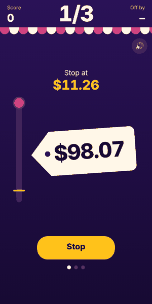
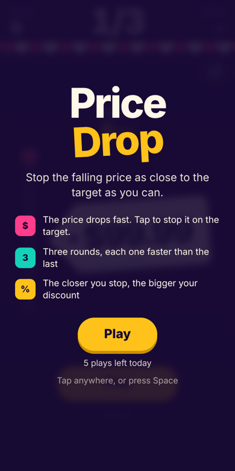
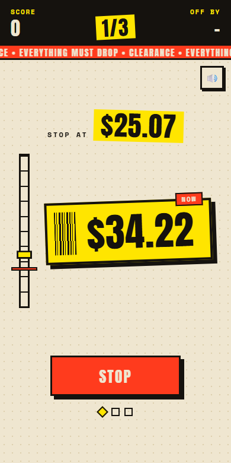
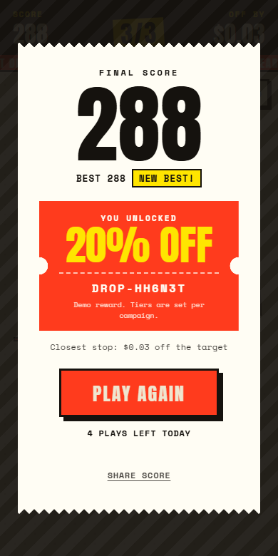

<div align="center">

# 🏷️ Price Drop

**Stop the falling price on the target. Unlock a discount.**

A 15-second, one-tap HTML5 game built for the Vouchermatic HTML5 Game Developer Challenge.

[](https://jasonchriscodes.github.io/Price-Drop/)




</div>

## How to play

1. A price tag drops quickly from **$99.99**.
2. Tap anywhere (or press **Space**) to stop it as close to the **target price** as you can.
3. Play three rounds. Each one is faster than the last, and if the price hits **$0.00** before you tap, the round ends with 0 points.
4. Your total score unlocks a voucher, from **5% off** up to **20% off**.

A perfect stop scores 100 points. You lose 8 points for every dollar you're off.

## Screenshots

| Start | Playing | Reward |
| :---: | :---: | :---: |
|  |  |  |

## Design

Price Drop looks like a **supermarket clearance aisle**, not a generic game UI:

- **Shelf-edge price label.** The falling price sits on a yellow label with a barcode strip and a "NOW" sticker.
- **Ruler meter.** A red marker shows the target and an ink block shows the current price.
- **Till-display HUD and clearance ticker.** A black score strip sits above a scrolling "CLEARANCE" band.
- **Receipt screens.** The start and results screens are torn thermal receipts, and the reward is a red notched coupon.
- **Type.** Anton for the big numbers and Space Mono for labels.

## Built for the brief

| Challenge requirement | How Price Drop meets it |
| --- | --- |
| Simple, minimal learning time | One action: tap to stop. Rules fit on one screen. |
| Quick to play and complete | Time-bound: three rounds, and each ends when the price hits $0, so a full game never runs past about 11 seconds. |
| Unique concept | A timing game built around a falling price, not a reskin of catch, match or tap games. |
| Customer engagement and campaigns | Score unlocks a reward tier with a voucher code, and players can share their score. |
| Repeat participation | Instant replay, saved best score and a daily play limit. |
| Runs smoothly on Android and iOS | Lightweight DOM rendering, touch-first input and safe-area support. |

## Features

- **Campaign-ready config.** Brand colours, difficulty, play limit and reward tiers all live in [`js/config.js`](js/config.js), so the game can be rebranded per client without touching game code.
- **Daily play limit.** Players get 5 plays a day by default (set `playsPerDay: 0` for unlimited).
- **Voucher reward.** Each result shows a reward tier and a generated voucher code.
- **Sound without files.** Effects are generated with the Web Audio API, so there's nothing to download.
- **Accessible.** Keyboard play, visible focus, screen-reader labels and reduced-motion support.
- **Pauses automatically** when the player switches tabs or apps.

## Customise for a campaign

```js
// js/config.js
PD.CONFIG = {
  codePrefix: 'DROP',
  playsPerDay: 5,
  speeds: [38, 55, 75],
  tiers: [
    { min: 270, off: '20% off' },
    { min: 200, off: '15% off' },
    { min: 120, off: '10% off' },
    { min: 0, off: '5% off' }
  ],
  theme: { paper: '#efe6d0', ink: '#15120e', red: '#ff3b1d', hi: '#ffe500' }
};
```

## Project structure

```
Price-Drop/
├── index.html          Page markup: HUD, play area, start and results screens
├── css/
│   ├── style.css       Theme, layout and in-game styles
│   └── screens.css     Start and results receipt screens, voucher coupon
├── js/
│   ├── config.js       Campaign settings and brand colours
│   ├── audio.js        Web Audio sound effects and haptics
│   ├── campaign.js     Daily play limit and score sharing
│   ├── game.js         Core loop: falling price, stopping, scoring
│   └── screens.js      Start screen, results and voucher reward
└── docs/screenshots/   Images used in this README
```

## Run locally

No build step or install is needed. Clone the repo and open `index.html` in a browser:

```bash
git clone https://github.com/jasonchriscodes/Price-Drop.git
cd Price-Drop
```

For testing on a phone over your local network, any static server works, for example `npx serve .`

## Author

**Jason Christian** · [LinkedIn](https://linkedin.com/in/jasonchriscodes) · [GitHub](https://github.com/jasonchriscodes)

Released under the [MIT License](LICENSE).
